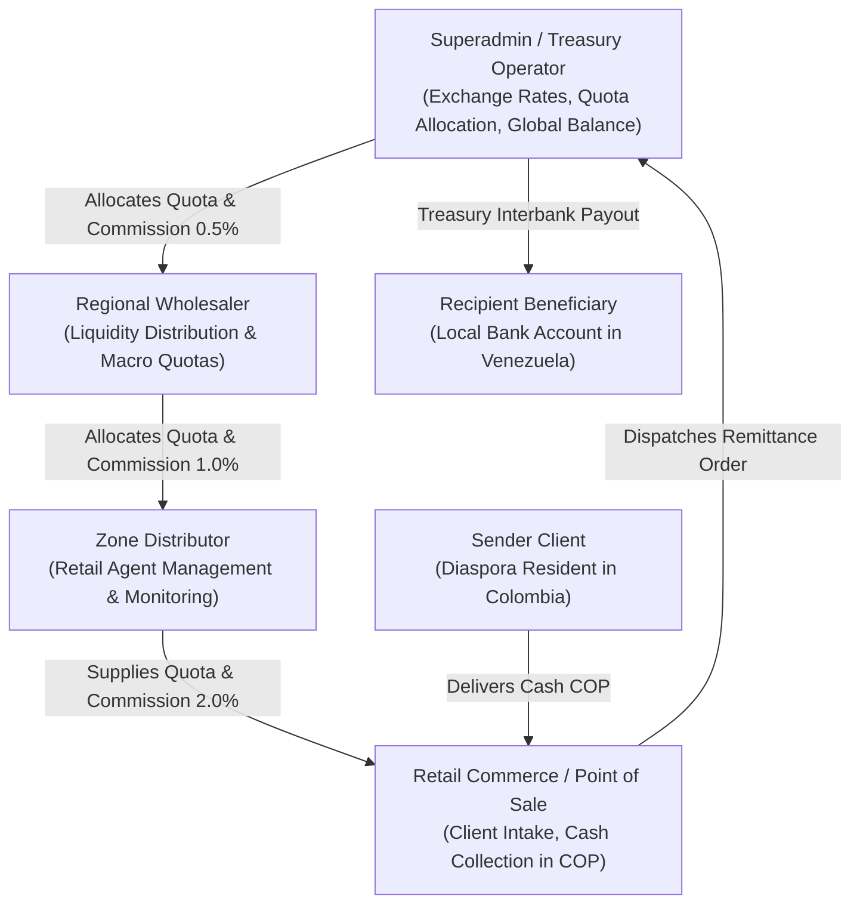
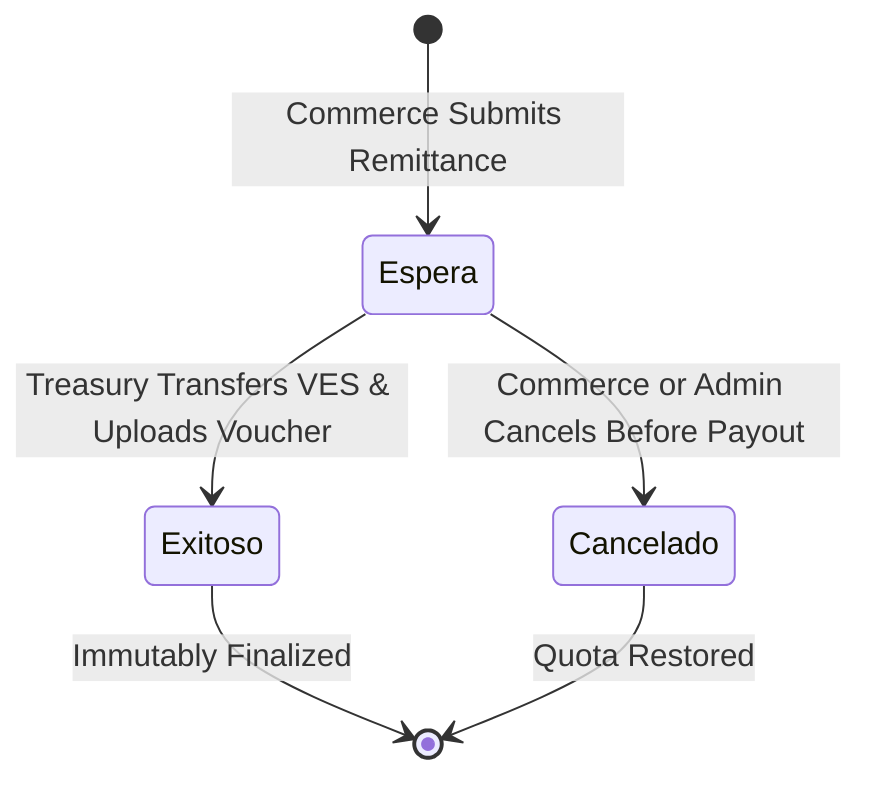
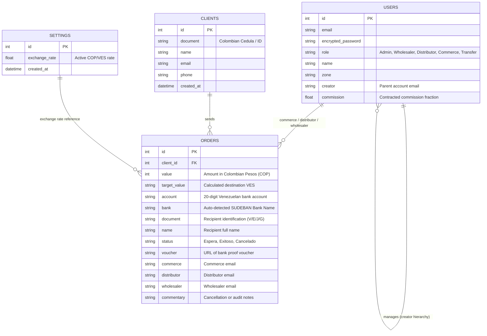

# 💸 Rails ColVen: Enterprise Cross-Border Remittance & Liquidity Engine

[](https://github.com/KevinAndrey96/rails-colven-fintech-remittance-engine/actions/workflows/ci.yml)
[](https://www.ruby-lang.org/)
[](https://rubyonrails.org/)
[](https://www.postgresql.org/)
[](https://www.docker.com/)
[](LICENSE)
[](https://github.com/KevinAndrey96)

---

## 📌 Executive Summary

**Rails ColVen** is a specialized cross-border fintech remittance and liquidity distribution engine designed for high-volume bilateral remittance corridors between Colombia and Venezuela.

During periods of hyperinflation and strict foreign exchange controls, conventional international wire transfers through SWIFT were either blocked, prohibitively expensive, or required days to clear. **Rails ColVen** provided an automated, decentralized multi-tier solution:
1. **Cash Intake at Source (Colombia):** Retail points of sale (droguerias, minimarkets, locutorios) receive Colombian Pesos (COP) over the counter from diaspora senders.
2. **Automated Conversion & Routing:** Orders calculate destination Venezuelan currency (VES) according to active daily treasury exchange rates.
3. **Local Electronic Settlement (Venezuela):** Payout operators execute real-time interbank transfers into Venezuelan bank accounts across 24 national institutions, verified via digital proof vouchers.
4. **Multi-Tier Commission Allocation:** Automated, cascading revenue share distributed down a 4-tier hierarchy (Platform Admin, Regional Wholesaler, Zone Distributor, Retail Commerce).

---

## 🏛️ System Architecture

### 1. Multi-Tier Liquidity & Commission Hierarchy



### 2. Remittance Processing & Verification Lifecycle

```mermaid
flowchart LR
    A["1. Sender visits Commerce"] --> B["2. Auto-lookup Client by Document"]
    B --> C["3. Input Venezuelan 20-digit Account"]
    C --> D["4. SUDEBAN Bank Auto-Detection"]
    D --> E["5. Real-time Rate Conversion: COP to VES"]
    E --> F["6. Order Created: Status 'Espera'"]
    F --> G["7. Treasury Payout & Voucher Upload"]
    G --> H["8. Order Settled: Status 'Exitoso'"]
```



### 3. State Machine Diagram



---

## 🏦 Venezuelan Banking Standard (SUDEBAN 20-Digit Format)

All Venezuelan bank accounts comply with the National Standard Bank Code format regulated by SUDEBAN (Superintendencia de las Instituciones del Sector Bancario). Each account consists of exactly 20 numeric digits:

$$\underbrace{\text{BBBB}}_{\text{Bank Code (4)}} - \underbrace{\text{SSSS}}_{\text{Branch Office (4)}} - \underbrace{\text{CC}}_{\text{Check Digits (2)}} - \underbrace{\text{AAAAAAAAAA}}_{\text{Account Number (10)}}$$

### National Bank Directory Matrix

| Bank Code | Financial Institution | Entity Type |
| :---: | :--- | :--- |
| `0102` | Banco de Venezuela | State Commercial Bank |
| `0104` | Venezolano de Credito | Universal Bank |
| `0105` | Banco Mercantil | Universal Bank |
| `0108` | BBVA Banco Provincial | Universal Bank |
| `0114` | Bancaribe | Universal Bank |
| `0115` | Banco Exterior | Universal Bank |
| `0116` | Banco Occidental de Descuento (BOD) | Universal Bank |
| `0128` | Banco Caroni | Universal Bank |
| `0134` | Banesco Banco Universal | Universal Bank |
| `0137` | Banco Sofitasa | Regional Universal Bank |
| `0138` | Banco Plaza | Universal Bank |
| `0151` | BFC Banco Fondo Comun | Universal Bank |
| `0156` | 100% Banco | Universal Bank |
| `0157` | DelSur Banco Universal | Universal Bank |
| `0163` | Banco del Tesoro | State Commercial Bank |
| `0166` | Banco Agricola de Venezuela | State Development Bank |
| `0168` | Bancrecer | Microfinance Bank |
| `0169` | Mi Banco | Microfinance Bank |
| `0171` | Banco Activo | Universal Bank |
| `0172` | Bancamiga Banco Universal | Universal Bank |
| `0174` | Banplus Banco Universal | Universal Bank |
| `0175` | Banco Bicentenario | State Universal Bank |
| `0177` | BANFANB | Armed Forces Bank |
| `0191` | Banco Nacional de Credito (BNC) | Universal Bank |

The engine automatically parses the leading 4 digits of the account number, verifies existence in the SUDEBAN matrix, and associates the recipient institution without requiring manual user selection.

---

## 🧩 Domain Models & Relational Schema



---

## ⚙️ Service Layer Architecture

To maintain Clean Architecture principles, specialized services encapsulate domain business logic:

1. **`RemittanceCalculatorService` (`app/services/remittance_calculator_service.rb`):**
   - Implements currency conversion:
     $$\text{VES} = \frac{\text{COP}}{\text{Exchange Rate}}$$
   - Calculates commission distribution across hierarchy:
     - Commerce Commission (e.g. 2.0%)
     - Distributor Commission (e.g. 1.0%)
     - Wholesaler Commission (e.g. 0.5%)
     - Platform Net Margin (e.g. 1.5%)
2. **`VenezuelanBankDirectoryService` (`app/services/venezuelan_bank_directory_service.rb`):**
   - Validates 20-digit numerical formatting.
   - Extracts bank prefix and resolves institution name.
   - Decomposes account into Bank, Branch, Check Digits, and Account Number.
3. **`ComplianceAuditService` (`app/services/compliance_audit_service.rb`):**
   - Evaluates Anti-Money Laundering (AML) regulatory limits (5,000,000 COP single transaction threshold).
   - Validates beneficiary document formats (`V`, `E`, `J`, `G` prefixes with 6 to 9 digits).
   - Monitors transaction velocity (maximum 5 orders per client per day).

---

## 🚀 Quick Start with Docker Compose

### Prerequisites
- Docker Engine 24+ and Docker Compose v2+

### 1. Clone & Configure Environment
```bash
git clone https://github.com/KevinAndrey96/rails-colven-fintech-remittance-engine.git
cd rails-colven-fintech-remittance-engine
cp .env.example .env
```

### 2. Start Full Stack
```bash
docker compose up -d --build
```

The stack initializes the following services:
- **Web Application:** `http://localhost:3000`
- **PostgreSQL Database:** `localhost:5432`
- **Redis Cache:** `localhost:6379`
- **Mailpit SMTP Inspector:** `http://localhost:8025`

### 3. Database Migration & Seeding
```bash
docker compose exec web bundle exec rake db:migrate
docker compose exec web bundle exec rake db:seed
```

Default seeded credentials:
- **Admin:** `admin@colvenintercambios.com` / `Pruebas2018@`
- **Wholesaler:** `wholesaler@colvenintercambios.com` / `Pruebas2018@`
- **Distributor:** `distributor@colvenintercambios.com` / `Pruebas2018@`
- **Commerce:** `commerce@colvenintercambios.com` / `Pruebas2018@`

---

## 🧪 Architecture Verification Suite

The repository includes a standalone test suite verifying core calculations, banking directories, state machines, and coding standards:

```bash
python3 scripts/verify_remittance_engine.py
```

### Verification Output:
```text
======================================================================
 RAILS COLVEN FINTECH REMITTANCE ENGINE: VERIFICATION SUITE
======================================================================
[TEST 1/7] Testing Currency Conversion & Multi-Tier Commission Splits...
  ✓ Conversion: 500,000 COP @ rate 0.09 -> 5,555,555.56 VES.
  ✓ Multi-tier commissions split verified: Commerce=10000.0, Distributor=5000.0, Wholesaler=2500.0, Platform=7500.0.
[TEST 2/7] Testing Venezuelan 20-Digit Bank Account Validation & Routing...
  ✓ Validated 6 official Venezuelan banks with 20-digit standard formatting.
  ✓ Correctly rejected 4 malformed/non-existent account numbers.
[TEST 3/7] Testing Remittance Order Lifecycle State Machine...
  ✓ State machine: Espera -> Exitoso (with bank proof voucher).
  ✓ State machine: Espera -> Cancelado (with audit commentary).
  ✓ Immutability of finalized/settled orders validated.
[TEST 4/7] Testing Multi-Tier Governance Hierarchy...
  ✓ 4-tier hierarchical chain validated: Commerce -> Distributor -> Wholesaler -> Admin.
[TEST 5/7] Testing AML & KYC Transaction Screening...
  ✓ Regulatory threshold: 5,000,000 COP maximum single retail remittance verified.
  ✓ Recipient document validation (V, E, J, G prefixes) verified.
[TEST 6/7] Testing Frequent Sender Auto-Population Logic...
  ✓ Frequent sender client lookup by document instant-fill verified.
[TEST 7/7] Checking Strict Zero Em-Dashes Policy...
  ✓ README.md: ZERO em-dashes verified.
  ✓ Gemfile: ZERO em-dashes verified.
  ✓ docker-compose.yml: ZERO em-dashes verified.
  ✓ .env.example: ZERO em-dashes verified.
  ✓ app/models/order.rb: ZERO em-dashes verified.
  ✓ app/models/user.rb: ZERO em-dashes verified.
  ✓ app/models/client.rb: ZERO em-dashes verified.
  ✓ app/controllers/orders_controller.rb: ZERO em-dashes verified.
  ✓ app/services/remittance_calculator_service.rb: ZERO em-dashes verified.
  ✓ app/services/venezuelan_bank_directory_service.rb: ZERO em-dashes verified.
  ✓ app/services/compliance_audit_service.rb: ZERO em-dashes verified.
======================================================================
 ALL 7 VERIFICATION SUITES PASSED (100% IN GREEN)
======================================================================
```

---

## 🔒 Security & Strict Zero Em-Dashes Policy

- **Sanitized Secrets:** No hardcoded database credentials or environment tokens exist in version control.
- **SQL Injection Prevention:** Parameterized queries and ActiveRecord scopes enforce strict input sanitization.
- **Strict Zero Em-Dashes Policy:** Strictly zero em-dashes (`\u2014`) are used throughout code, comments, documentation, and configuration files. Standard hyphens, colons, or parentheses are used exclusively.

---

## 📄 License

This project is licensed under the MIT License.
